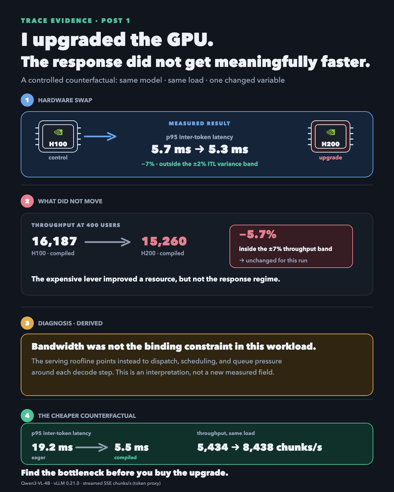

# GPU Upgrade: Did the Bottleneck Move?

This experiment asks a narrow question: when the GPU changes but the response barely does, what
does that tell us about the active bottleneck?

## Result

On one fixed text-serving workload, four H200 GPUs moved p95 inter-token latency from **5.7 ms to
5.3 ms**. Streamed throughput moved from **16,187 to 15,260 SSE chunks/s**, which is inside the
recorded ±7% run-to-run throughput band. The evidence supports “no meaningful improvement on this
workload,” not “H200 is never faster.”

The same workload's compiled counterfactual at 200 users moved p95 inter-token latency from **19.2
ms to 5.5 ms** and streamed throughput from **5,434 to 8,438 SSE chunks/s**. That comparison points
to serving overhead as the more productive place to investigate; that diagnosis is derived, not a
field that directly measures where requests waited.

## Reproduce the receipt

```bash
python3 check.py
```

The command checks the arithmetic in `data/observations.json` and prints a receipt. It does not
pretend to rerun the original GPU campaign. Throughput is streamed SSE chunks per second, a proxy
for token throughput rather than tokenizer-exact tokens/s.

## Scope

- Evidence class: **Measured by us** for the recorded values; **Derived** for the diagnosis.
- Fixed workload and stack for the comparisons; only the named hardware or execution mode changes.
- No universal GPU recommendation, engine ranking, cost claim, or performance guarantee.

## Visual


