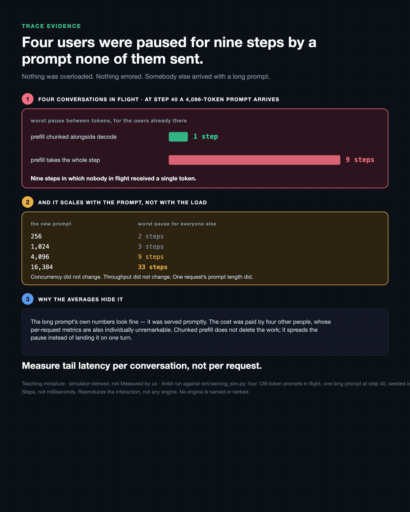

# One long prompt pauses every conversation already in flight

**Evidence class:** Teaching miniature — simulator-derived, **not** Measured by us
**Provenance:** my own run against [`sim/serving_sim.py`](../../sim/serving_sim.py)

## The question

Four conversations are mid-flight on short prompts. A fifth user arrives with a 4,096-token prompt.
Nothing is overloaded and nothing errors. What happens to the four?



```
$ python3 long_prompt_stall.py

    new prompt | worst gap for the users already there
  -------------+---------------------------------------
           256 |                                2 steps
         1,024 |                                3 steps
         4,096 |                                9 steps
        16,384 |                               33 steps

  decode tokens delivered to the four original users
    no long prompt arrives     436
    long prompt at step 40     436   +0.0 %

  each affected user, seen alone
      user | median gap | worst gap
         0 |          1 |         9
```

## What it shows

1. **Prefill and decode compete for the same forward pass.** A step spent reading a long prompt is
   a step in which nobody already in flight receives a token.
2. **It scales with the prompt, not with the load.** Concurrency, throughput and queue depth are
   unchanged across those four rows. One request's prompt length changed.
3. **Per-request metrics are structurally blind to it.** Throughput to the four is unchanged at
   +0.0%: the tokens still arrive, they arrive later. The long request's own worst gap is 1 step,
   so its numbers look fine. Every affected user's *median* gap is 1 step while their worst is 9.
   Nothing in a per-request average shows this. Only the gap inside one conversation does.
4. **Chunked prefill takes the worst pause from 9 steps to 1** — by spreading the work, not by
   removing it.

Point 3 was prose in an earlier version of this receipt. It is now computed and asserted, including
a control run in which no long prompt arrives.

## Boundary

Steps, not milliseconds. A simulator, not a measurement of any engine, and no engine is named or
ranked. Real schedulers have more machinery than this: priority classes, prefill chunk sizing,
admission policy. The mechanism survives them; the specific step counts do not transfer.

## Run it

```bash
python3 long_prompt_stall.py
```

Standard library only. The script asserts its own headline figures.
