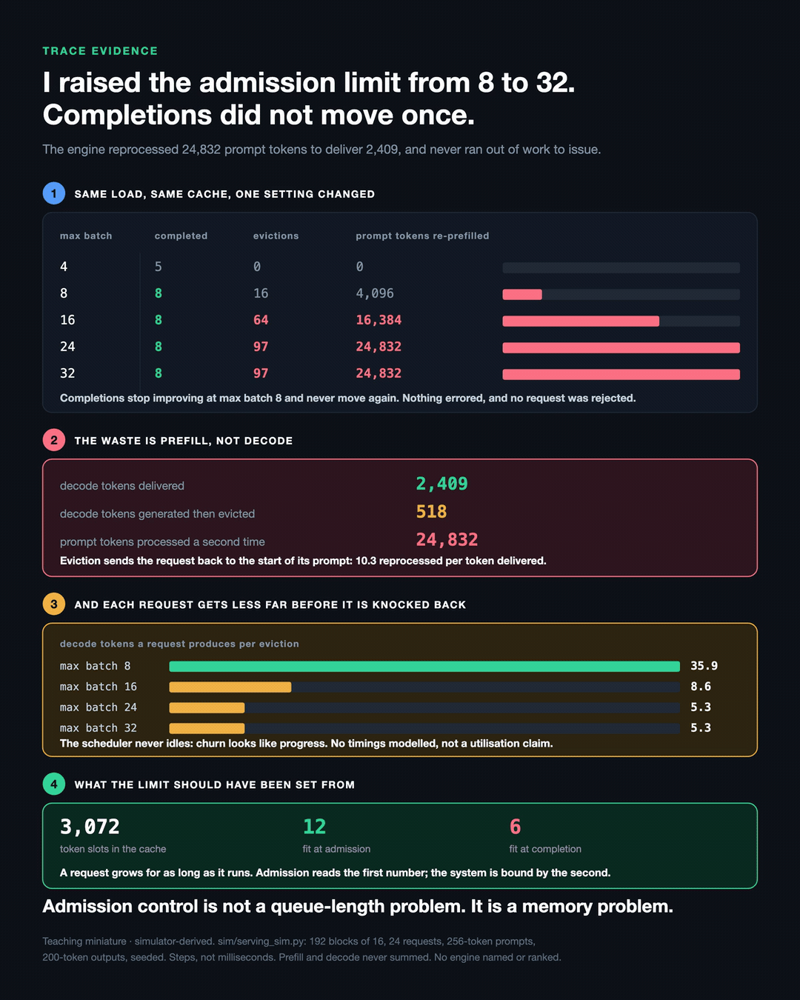

# Over-admission does not reduce completions. It converts them into repeated work.

**Evidence class:** Teaching miniature — simulator-derived, **not** Measured by us
**Provenance:** my own run against [`sim/serving_sim.py`](../../sim/serving_sim.py)

## The question

If a serving engine's KV cache is the thing that runs out, what does raising the admission limit
actually buy? The answer is not "fewer completions". It is the same completions, paid for again.



```
$ python3 preemption_thrash.py

   max batch | completed | evictions | prompt tokens re-prefilled
           4 |         5 |         0 |          0
           8 |         8 |        16 |      4,096
          16 |         8 |        64 |     16,384
          24 |         8 |        97 |     24,832
          32 |         8 |        97 |     24,832

  decode tokens delivered                2,409
  decode tokens generated then evicted     518
  prompt tokens processed a second time 24,832
```

## What it shows

1. **Completions plateau at 8 and never move again**, from max batch 8 through 32. Nothing errors
   and no request is rejected.
2. **The waste is prefill, not decode.** An evicted request loses its cache and restarts from its
   prompt, so the engine reprocessed 24,832 prompt tokens to deliver 2,409 output tokens — 10.3
   reprocessed per token delivered. Only 518 generated tokens were actually thrown away.
3. **Each request gets less far before it is knocked back**: 35.9 decode tokens per eviction at
   max batch 8, 8.6 at 16, 5.3 at 24 and 32.
4. **The limit should have been set from the cache, not the queue.** 3,072 token slots fit 12
   requests at admission and 6 at completion, because a request grows for as long as it runs.
   Admission control reads the first number; the system is bound by the second.

## Boundary

**This says nothing about GPU utilisation.** `serving_sim.py` states that it "does NOT model
kernels, precision, real timings, or any specific engine", so it cannot. What it observes is a
scheduler property: the set of admitted requests is never empty, so the engine always has work to
issue. Whether that keeps a real device busy is a different question, and this artifact does not
answer it. An earlier version of this receipt claimed otherwise.

Steps, not milliseconds. It reproduces a mechanism and its shape; it is not a benchmark, and no
engine is named or ranked. Real schedulers use watermarks, swapping and smarter victim selection,
all of which change the numbers and none of which remove the trade-off.

This run has **no prefix cache**. 24,832 is this configuration's re-prefill cost. What a
cache-enabled engine would pay is not measured here, and no bound is claimed on it.

## Run it

```bash
python3 preemption_thrash.py
```

Standard library only. The script asserts its own headline figures.
