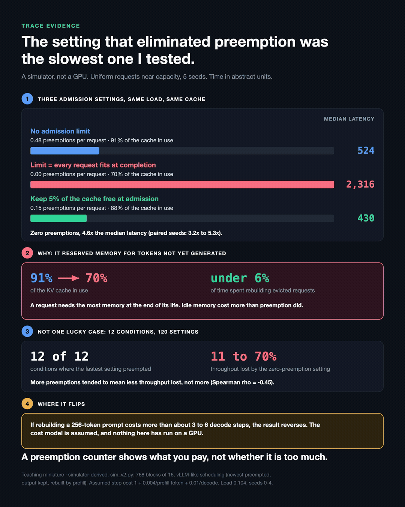
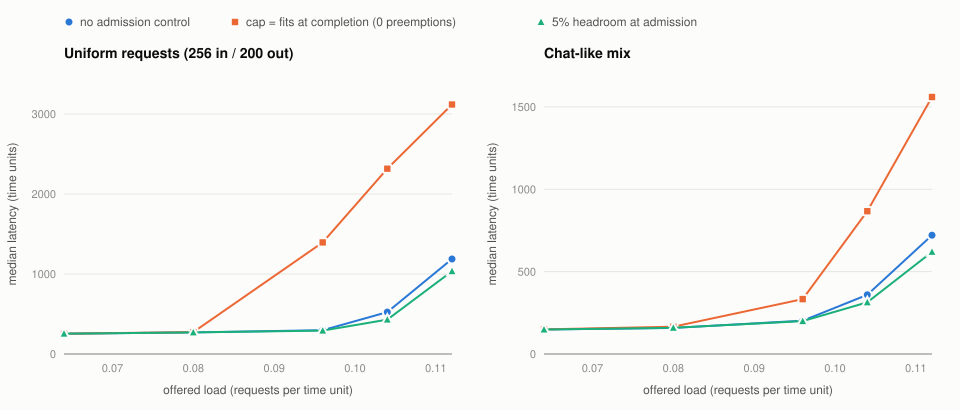

# Preemption thrash, extended: the preemption counter points the wrong way

**Evidence class:** Teaching miniature, simulator-derived. **Not** a measurement of any engine or GPU.
Every time is in abstract units (u), never milliseconds. Nothing here proves production behaviour.

The original experiment one folder up concluded that over-admission plateaus throughput while
eviction and recomputation climb, and that the admission limit should be sized so every running
request still fits at completion. This folder audits that experiment, rebuilds the simulator where
the audit found problems, and tests the conclusion under conditions closer to a real engine.

**The original conclusion does not survive.** In this simulator, with vLLM-like preemption semantics
and a cost for recomputation, the admission limit the original post recommends removes almost every
preemption and makes median latency **2.5x (chat mix) to 4.6x (uniform requests) worse** at a load
near capacity, because it leaves about 22 to 30% of the KV cache idle. Across every condition tested, the highest-throughput admission
policy preempted, and the zero-preemption policy was 10.6% to 69.5% slower.



---

## 1. Audit of the original experiment

`audit_original.py` instruments the original `sim/serving_sim.py` without changing it: a line-for-line
copy of `Engine.step` with read-only counters, checked to reproduce the original per-step log exactly.
Output: [`results/audit_original.txt`](results/audit_original.txt).

| # | Finding | Evidence | Effect on the original conclusion |
|---|---|---|---|
| A1 | **Prefill allocates KV without checking free blocks.** | After the prefill phase the engine holds up to **224 of 192 blocks**; over capacity in 110 of 400 steps at max batch 24/32. The decode phase then preempts its way back. | Evictions are partly caused by physically impossible over-commit. |
| A2 | **Admission reserves nothing.** An admitted request holds zero blocks until it prefills. | 20 steps admit several requests against the same free blocks; up to **23 requests run at once** in a cache that holds 12 bare prompts. | Same as A1. |
| A3 | **A request that evicts itself still gets a token that step.** | 4 to 7 such tokens per run. | Negligible, but a correctness bug. |
| A4 | **Every step costs the same.** | Prefill per step ranges 0 to 512 tokens; every step costs 1. | **Recomputation is free in time**, so a throughput plateau is guaranteed by construction rather than discovered. |
| A5 | **Eviction discards generated tokens and re-decodes them.** | `serving_sim.py` resets `generated` to 0. vLLM V1 keeps output tokens and rebuilds their KV by prefill (`scheduler.py`, `_preempt_request`). | Decode is the expensive way to rebuild; this makes eviction look far costlier than in vLLM. |
| A6 | **Max batch 32 is identical to 24.** | Only 24 requests exist; per-step logs for 24 and 32 are identical. | The "32" row adds no information. |
| A7 | **Completion counts are window-bound.** | Given 800 steps, every limit from 8 up completes all 24 requests (by step ~799); max batch 4 needs ~1,211. | "Completions did not move" is a 400-step window artefact; the run-to-completion figure is makespan. |

Answers to the audit questions:

1. *Logically correct?* Mostly, but A1 to A3 are real bugs.
2. *Metrics accurately defined?* After the earlier queue-undercount fix, yes. But "decode tokens lost"
   exists only because of A5; under vLLM's semantics it is zero.
3. *Hidden assumptions that make it trivial?* Yes: A4. With free recomputation, more admission can
   never cost throughput, so a plateau is the only possible outcome.
4. *Plateau emergent or designed?* Designed. The plateau survives fixing A1 to A3 (`e1`, "original
   semantics, steps free") and disappears as soon as steps have a cost.
5. *Distinguishes preemption, eviction, recomputation, completed work?* It conflates preemption with
   loss of output (A5). The rebuilt simulator separates resident KV, KV destroyed by eviction, KV
   rebuilt by recompute, KV restored from a prefix cache, and delivered output, and asserts that they
   balance.
6. *Capacity claims justified?* The arithmetic (12 fit at admission, 6 at completion) is right, but
   the inference from it, that the limit should be 6, is not. The sustainable concurrency depends on
   *average* occupancy over a request's life, and an engine that can preempt does not need to reserve
   for the worst case. That is the main result below.
7. *Transfer to vLLM?* Not as stated, for A4 and A5. See section 6.

## 2. The rebuilt simulator (`sim_v2.py`)

The original simulator is untouched and the original experiment still runs against it. `sim_v2.py`
is a separate engine:

- KV blocks are allocated before a step runs, for exactly the tokens that step computes. Capacity is
  asserted every step.
- Scheduling follows vLLM V1's documented chunked-prefill policy: running requests first, then
  waiting requests while a 512-token budget lasts. The **newest running request is the victim**,
  victims go to the **front** of the queue, and **generated tokens survive** preemption (their KV is
  rebuilt by prefill). These choices were checked against vLLM's `v1/core/sched/scheduler.py`.
- **Step time is assumed**: `dt = 1 + a x prefill tokens + 0.01 x decoding sequences`, with
  `a = 0.004` (one 256-token re-prefill costs about one decode step). This is an order-of-magnitude
  choice for a dense ~8B model; `e2` sweeps it from 0 to 0.04 and reports where conclusions flip.
- Optional **prefix cache**: a request's own freed blocks keep their contents until reallocated,
  least-recently-freed first, tail blocks first. This follows vLLM's block-pool design as I understand
  it. Cross-request sharing (common system prompts) is not modelled.
- Admission policies: `cap` (vLLM-like optimistic: admit if the first chunk fits, plus a concurrency
  cap, the role `max_num_seqs` plays), `watermark` (the same, keeping a fraction of blocks free), and
  `reserve` (admit only if every running request could reach `max_tokens` without preemption).

`test_sim_v2.py` checks capacity, token conservation, the reserve policy never preempting, and that
recomputed plus cache-restored KV equals destroyed KV exactly.

**Not modelled:** real kernels or timings, attention cost growth with context length, CUDA graphs,
tensor parallelism, swapping, speculative decoding, cross-request prefix sharing, or any named engine.
The cache is 192 blocks (x1) or 768 blocks (x4), tiny next to a real GPU. What transfers, if anything,
is ratios such as request footprint relative to cache, not absolute counts.

Workloads (`workloads.py`, seeded): `burst24` (the original), `homog` (Poisson, 256 in / 200 out),
`chat` (Poisson, lognormal prompt and output lengths, heavy output tail; an assumed shape, not fitted
to a trace), `bimodal` (80% short answers, 20% long). Seeds 0 to 4 everywhere.

## 3. Research questions, ranked

| Rank | Question | Already understood | What was uncertain | Experiment | Answer here |
|---|---|---|---|---|---|
| 1 | **Is a preemption a cost signal or a health signal?** Does eliminating preemption improve service? | vLLM's design (PagedAttention paper) argues for optimistic allocation with preemption over reservation. | Whether "fewer preemptions" is a safe tuning target; the vLLM guide lists lowering `max_num_seqs` as one way to reduce preemption. | `e3`, `e4b`, `e7` | **No, it isn't a safe target.** Zero-preemption policies were the slowest in every condition tested. Strongest finding; section 4. |
| 2 | **When does over-admission pay?** | Recomputation has a cost; preemption trades memory for compute. | Where the break-even sits, and whether the original "restart" semantics change the sign. | `e1`, `e2` | Pays while one 256-token re-prefill costs under about 3 (chat) to 6 (uniform) decode steps; with the original semantics it barely pays at all. The original post's conclusion came from its semantics. |
| 3 | **Is there an optimum between no admission control and worst-case reservation?** | vLLM V0 had a 1% admission watermark "to avoid frequent cache eviction"; current V1 source has a `watermark` defaulting to 0. | Its size and value. | `e3`, `e4` | An inverted U peaking at 2 to 10% free. Throughput gain is **+3% to +15% without a prefix cache but at most +2% with one**; near capacity it lowers median latency 11 to 17%. Real but modest. |
| 4 | **What is a preemption made of?** | LIFO victim selection is unfair in principle. | How much of the count is wasted churn, and how concentrated. | `e5` | At the small cache, ~80% of preemptions hit a request that had produced nothing since admission, and the top 1% of requests absorb 59 to 88% of preemptions (one request: 244 times). **At the 4x cache this weakens** (21 to 40% concentration, 28 to 52% zero-progress), so it is partly a small-cache effect. |
| 5 | **Does thrash cause metastable failure after a burst?** | Metastable failures arise when recovery work exceeds spare capacity. | Whether recompute churn is enough. | `e6` | **No bistability.** Both policies recover; with 5% headroom the post-burst queue is ~30% smaller between t = 10k and 15k. Ordinary queueing, not hysteresis. |

Considered but not run: fairness by request size under LIFO, prefix-sharing workloads, and the
phase-alignment question (synchronised versus staggered arrivals change safe concurrency). The burst
in `e1` versus the Poisson runs hints that alignment matters; it is not tested here.

## 4. Strongest finding: the zero-preemption setting is the slow one

**Research question.** If an operator lowers the concurrency limit until preemptions stop, which is
what the original post recommends and one of the remedies the vLLM optimization guide lists, does
service improve?

**Hypothesis (the original post's).** Sizing admission so every running request fits at completion
removes wasted recomputation and improves, or at least does not hurt, throughput and latency.

**Setup.** `sim_v2`, x4 cache (768 blocks x 16 tokens), prefix cache on, vLLM-like scheduling,
`a = 0.004`. Poisson arrivals at five offered loads; 2,400 requests per run, requests 400 to 1,999
measured; seeds 0 to 4, paired (same arrivals for every policy). Policies: no admission control; cap
24 (6 x 4: the post's "fits at completion" limit for 256/200 requests); cap 32; 5% headroom.

**Results** ([`results/e4b_cap_remedy.txt`](results/e4b_cap_remedy.txt), [`results/headline.txt`](results/headline.txt)):

| Workload | Load (req/u) | Policy | Preemptions / request | KV usage | Median latency | p99 latency |
|---|---|---|---|---|---|---|
| uniform | 0.104 | no admission control | 0.48 | 0.91 | 524 | 848 |
| uniform | 0.104 | **cap 24 (fits at completion)** | **0.00** | 0.70 | **2,316** | **3,707** |
| uniform | 0.104 | 5% headroom | 0.15 | 0.88 | 430 | 740 |
| chat mix | 0.104 | no admission control | 0.47 | 0.87 | 359 | 1,505 |
| chat mix | 0.104 | **cap 24** | **0.02** | 0.78 | **867** | **2,011** |
| chat mix | 0.104 | 5% headroom | 0.02 | 0.84 | 314 | 1,434 |

Per-seed paired ratios, cap 24 / no admission control (min to max over 5 seeds):

| Workload | Load | Median latency | p99 latency |
|---|---|---|---|
| uniform | 0.096 | x4.69 (3.55 to 5.63) | x4.27 (3.48 to 5.15) |
| uniform | 0.104 | x4.63 (3.19 to 5.25) | x4.45 (3.76 to 5.22) |
| uniform | 0.112 | x2.68 (2.32 to 3.18) | x2.72 (2.43 to 3.09) |
| chat mix | 0.096 | x1.62 (1.42 to 1.99) | x1.04 (1.00 to 1.14) |
| chat mix | 0.104 | x2.50 (2.02 to 3.16) | x1.33 (1.18 to 1.53) |
| chat mix | 0.112 | x2.52 (1.59 to 3.36) | x1.62 (1.32 to 1.85) |

At light load (0.064 to 0.080) median latency is within a few per cent. From 0.096 up, median latency
is worse under cap 24 in every paired seed (p99 is level in some chat seeds at 0.096).

Saturation throughput ([`results/e3_admission.txt`](results/e3_admission.txt), x4, prefix cache on,
paired against no headroom): "fits at completion" cap **-14.7%** (uniform), **-10.1%** (chat);
reserving `max_tokens` **-9.5%** (uniform), **-57.9%** (chat), **-48.7%** (bimodal). Across all 12
conditions (3 workloads x 2 cache sizes x prefix cache off/on), the best policy preempted 0.04 to
0.74 times per request, and the zero-preemption policy was 10.6% to 69.5% below it
([`results/e7_metrics.txt`](results/e7_metrics.txt)).



**Mechanism.** A request's KV footprint grows from its prompt to prompt + output. Sizing admission
for the end state reserves, at every moment, the memory each request *will* need, not what it needs
now. Averaged over a request's life that leaves 22 to 30% of the cache idle (KV usage 0.70 vs 0.91 on
uniform requests, 0.78 vs 0.87 on the chat mix, at load 0.104). Fewer requests decode per step, so the service rate falls, and near capacity queueing delay
grows sharply as the service rate approaches the arrival rate. Preemption is the price of using that
idle memory, and with vLLM-like resume plus a prefix cache it is small: recomputation took 3.6% to
5.6% of simulated time at zero headroom (x4, prefix on). Idle memory costs more than recomputation.

**Alternative explanations considered.**

- *The cost model favours preemption.* Partly true, and bounded: `e2` shows over-admission stops
  paying once a 256-token re-prefill costs more than
  (a ~ 0.011 to 0.025): about 3 decode steps (chat) to 6 (uniform). The default is 0.004.
- *The prefix cache makes recomputation unrealistically cheap.* The result holds without it: E3, x4,
  prefix off, cap 6x4 is -12.7% (uniform).
- *Small-cache artefact.* The cap effect holds at both x1 and x4 in `e3`. The latency table is x4 only.
- *Window or warm-up artefact.* Runs go to completion; latency is measured on requests 400 to 1,999 of
  2,400 to exclude warm-up and drain.
- *One lucky seed.* Every paired seed agrees at loads of 0.096 and above.
- *Cap 24 is just a badly chosen number.* It is the number the original post derives. Cap 32 (a
  moderate cap) was among the best policies, which says admission control helps; worst-case sizing
  is the problem.

**Limitations.** Simulation only; the step-cost model and workload shapes are assumptions; the cache
is tiny; there is no attention-cost growth with context, which would penalise high concurrency more
than this model does; prefix caching is modelled for a request's own blocks only; latency is in
abstract units. None of this has been run on hardware.

**Relationship to real engines.** The scheduling semantics were checked against vLLM V1 source:
newest-first victim, prepend to waiting, output tokens kept, admission allocating only the tokens
scheduled this step, and an admission `watermark` that defaults to 0 in `kv_cache_manager.py`. vLLM
exposes `vllm:num_preemptions`, `vllm:request_num_preemptions` and `vllm:kv_cache_usage_perc`; its docs
list no metric that directly counts tokens recomputed after preemption. Whether the magnitudes here
appear on real hardware is untested; it depends on the real prefill-to-decode cost ratio, prefix-cache
hit rates, and how attention cost grows with batch context.

**Practical implications (hypotheses for a real engine, not conclusions).**

- Treat a preemption counter as a cost signal, not a health signal. Here it was *negatively*
  correlated with lost throughput across 120 configurations (Spearman rho = -0.45), and KV usage more
  so (-0.66). Neither tells you that you are wasting capacity by being too conservative.
- Do not drive preemptions to zero by lowering the concurrency limit without measuring latency and
  throughput at your real load. Here, on uniform requests, that move cost 12.7 to 21.0% of saturation
  throughput across conditions and multiplied median latency by 2.7 to 4.7 near capacity; on the chat
  mix, 3.9 to 15.9% and 1.6 to 2.5x. On the bimodal mix a low cap did not stop preemption at all.
- If preemptions are frequent, a small admission headroom (2 to 5% of blocks) removed most of them
  here at no throughput cost (within +/-2% with a prefix cache), and lowered median latency 11 to
  17% near capacity.
- The quantity worth observing is time spent recomputing evicted KV against the throughput being
  bought with it. That needs instrumentation most deployments do not have.

## 5. Other results

- `e1` / `fig1`: the original 24-request workload. With the original semantics plus step costs,
  admitting past 6 *loses* throughput (5.38 to 5.11 tok/u). With vLLM-like resume it *gains* 14% (to
  6.16) and lowers p99 from 804 to 677, with 27 preemptions.
- `e2` / `fig2`: break-even recompute cost for over-admission, for both semantics.
- `e3` / `fig3`: the headroom inverted U, with and without a prefix cache.
- `e5`: eviction anatomy and the victim/requeue variants that break the LIFO ping-pong.
- `e6` / `fig5`: burst recovery. No hysteresis.
- `e7` / `fig4`: the three observables against lost throughput.

## Run it

```bash
python3 test_sim_v2.py          # invariants (about 5 s)
python3 audit_original.py       # audit of the original simulator
python3 experiments.py all      # every experiment, results/ (about 3 min on 10 cores)
python3 plots.py                # plots/*.svg from results/
```

Standard library only. Deterministic: rerunning reproduces every results file byte for byte.
